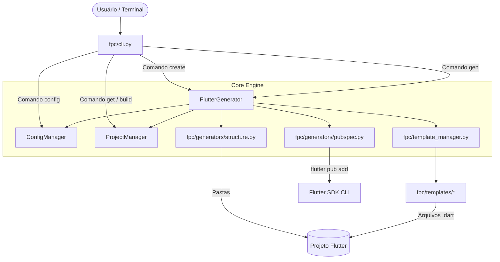

# FPC Architecture Overview

> Visão geral da arquitetura do **FPC (Flutter Project Companion)**.

---

## 1. O que é o FPC?

O **FPC** é uma ferramenta de linha de comando (CLI) desenvolvida em **Python** projetada para automatizar e padronizar o scaffolding de projetos **Flutter**.

Ele resolve a complexidade de iniciar novos projetos Flutter ao permitir a escolha de:
- **Padrões de Arquitetura**: Clean Architecture, MVVM (Model-View-ViewModel), MVC (Model-View-Controller).
- **Estruturas de Diretórios**: Standard (Layer First) ou Modular (Feature First).
- **Gerenciadores de Estado**: BLoC, Cubit, Provider, Riverpod, GetX, MobX ou None.
- **Clientes HTTP**: Dio, http ou None.
- **Bancos de Dados Locais**: SQLite (sqflite), Hive, Isar, ObjectBox ou None.
- **BaaS (Backend as a Service)**: Firebase, Supabase, Appwrite ou None.

---

## 2. Diagrama de Fluxo Geral

---

## 3. Módulos e Componentes

### 3.1 `fpc/cli.py` (Ponto de Entrada)
- **Função**: Interpreta os comandos e argumentos do terminal usando `argparse`.
- **Comandos Principais**:
  - `create`: Cria um novo projeto Flutter interativamente ou headless com flags (`--arch`, `--state`, `--http`, `--db`, `--baas`, `--structure`).
  - `gen`: Gera componentes individuais (`controller`, `viewmodel`, `cubit`, `view`, `model`, `service`, `feature`).
  - `init`: Inicializa o arquivo de configuração `.fpc.json` em um projeto Flutter existente.
  - `config`: Consulta ou atualiza configurações do projeto local.
  - `doctor`: Diagnostica ferramentas instaladas (Flutter, Dart, Git).

### 3.2 `fpc/generators/generator.py` (`FlutterGenerator`)
- **Função**: O maestro do gerador.
- **Responsabilidades**:
  - Apresenta menus interativos formatados com a biblioteca `rich`.
  - Normaliza os parâmetros fornecidos e monta as preferências do projeto.
  - Orquestra a criação de pastas, templates e injeção de dependências.
  - Implementa a geração de *features* completas (`_generate_feature`).

### 3.3 `fpc/generators/structure.py`
- **Função**: Cria as árvores de diretórios necessárias no sistema de arquivos.
- **Diferenciação**:
  - **MVC**: `models/`, `views/`, `controllers/`, `services/`, `repositories/`, `widgets/`.
  - **MVVM**: `models/`, `views/`, `viewmodels/`, `services/`, `repositories/`, `widgets/`.
  - **Clean Architecture**: `core/`, `domain/` (entities, repositories, usecases), `data/` (datasources, models, repositories), `presentation/` (pages, widgets e pasta de estado correspondente: `bloc`, `cubit`, `notifiers`, `controllers`, `store`).

### 3.4 `fpc/template_manager.py` (`TemplateManager`)
- **Função**: Resolvedor central de conteúdo de templates.
- **Mapeamento dinâmico**: Mapeia o par `(file_type, state_management)` para o módulo Python correspondente.
- **Fallback**: Se um gerenciador de estado não tiver um template específico para determinado tipo (ex: `repository`), recorre ao template genérico em `fpc.templates.generic`.

### 3.5 `fpc/generators/pubspec.py` (`update_pubspec`)
- **Função**: Injeta automaticamente os pacotes e dependências compatíveis no `pubspec.yaml` do projeto gerado.
- **Mecanismo**: Utiliza `flutter pub add <pacotes>` diretamente via `subprocess.run`, garantindo resolução de versões compatíveis com o SDK instalado.

### 3.6 `fpc/config_manager.py` (`ConfigManager`)
- **Função**: Salva e carrega o arquivo `.fpc.json` na raiz do projeto gerado, permitindo que comandos subsequentes (como `fpc gen`) saibam qual arquitetura e gerência de estado estão ativas sem perguntar novamente.

