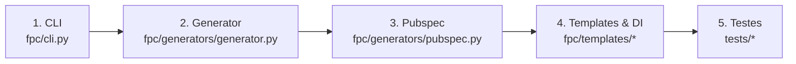

# Como Adicionar Novas Opções ao FPC (Passo a Passo)

> Tutorial para desenvolvedores que desejam estender o FPC com novas opções de gerência de estado, bancos de dados, BaaS ou arquiteturas.

---

## Introdução: O Ciclo de 5 Pontos

Sempre que você for adicionar uma opção (exemplo: uma nova gerência de estado chamada `Signal`), você seguirá este fluxo de 5 etapas:



---

## Passo 1: Atualizar a CLI (`fpc/cli.py`)

No arquivo `fpc/cli.py`, adicione o novo identificador aos `choices` do subcomando correspondente:

```python
# Em create_parser:
create_parser.add_argument(
    '--state',
    choices=['provider', 'bloc', 'cubit', 'signal', 'getx', 'riverpod', 'mobx', 'none'],
    help='State management'
)
```

---

## Passo 2: Atualizar o Gerador Principal (`fpc/generators/generator.py`)

1. Adicione o nome de exibição na lista de opções do menu interativo:
   ```python
   self.state_management_options = [
       'Provider',
       'BLoC',
       'Cubit',
       'Signal',
       'GetX',
       'Riverpod',
       'MobX',
       'None',
   ]
   ```

2. Se a opção influenciar o nome da pasta em Clean Architecture, adicione em `_generate_feature`:
   ```python
   elif 'signal' in sm: state_folder = 'signals'
   ```

3. Mapeie em `fpc/generators/structure.py` se afetar a criação de pastas iniciais:
   ```python
   elif 'signal' in sm_lower:
       state_folder = 'signals'
   ```

---

## Passo 3: Mapear Pacotes no `pubspec.yaml` (`fpc/generators/pubspec.py`)

Adicione os pacotes necessários que devem ser instalados via `flutter pub add`:

```python
elif state_management == 'Signal':
    deps_to_fetch.add('signals_flutter')
```

Se a opção necessitar de injeção de dependência via `get_it`, inclua-a na condição:
```python
if architecture == 'Clean Architecture' or state_management in ['Provider', 'BLoC', 'Cubit', 'Signal', 'MobX', 'None']:
    deps_to_fetch.add('get_it')
```

---

## Passo 4: Criar Templates e Registrar no `TemplateManager`

1. Crie a pasta do template, ex: `fpc/templates/signal/`:
   - `controller_template.py`: define a função `get_signal_controller_template(class_name: str) -> str`.
   - `view_template.py`: define a função `get_signal_view_template(class_name: str, base_name: str) -> str`.

2. Registre em `fpc/template_manager.py`:
   ```python
   'signal': {
       'controller': 'fpc.templates.signal.controller_template',
       'viewmodel': 'fpc.templates.signal.controller_template',
       'view': 'fpc.templates.signal.view_template',
   }
   ```

3. Configure o envelopamento do app no `fpc/templates/common/main_template.py` (se aplicável) e no `fpc/templates/templates.py`.

---

## Passo 5: Atualizar Critérios de Validação e Testes

1. Adicione a nova opção em `tests/validation_criteria.py`:
   - `STATE_PRESENTATION_DIRS`
   - `expected` em `validate_main_dart`
   - `expected_deps` em `validate_pubspec_deps`

2. Adicione testes unitários:
   - `tests/test_pubspec.py`: verifica se os pacotes esperados foram adicionados à lista de subprocess.
   - `tests/test_template_manager.py`: valida prevenção de sufixo duplo e integridade do código gerado.
   - `tests/stress_test.py`: adiciona um cenário de scaffolding completo.

3. Execute os testes:
   ```bash
   pytest -v
   ```
   Todos os testes devem passar sem erros!

